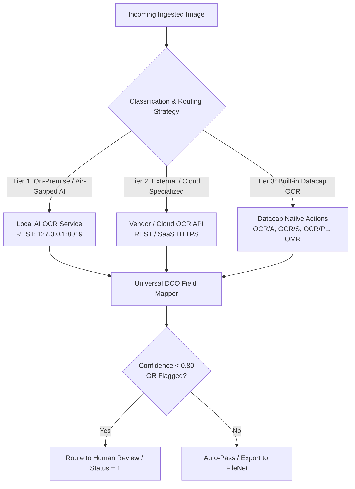

# IBM Datacap Universal OCR Strategy & Integration Guide

IBM Datacap supports multiple OCR strategies depending on data residency, network isolation, document language, and cost requirements. This skill provides the **decision matrix**, **expected inputs/outputs**, and **universal integration patterns** across all three tiers.

---

## 1. OCR Architecture & Decision Matrix



### When to choose which OCR tier:

| Strategy Tier | Typical Use Cases & Strengths | Limitations & Caveats | Example Action / Service |
| :--- | :--- | :--- | :--- |
| **Tier 1: Local AI OCR** | Air-gapped environments, strict data residency, custom Arabic LoRA adapters (e.g. handwritten names, custom forms). | Requires local GPU/compute server running FastAPI/Flask model service. | `LocalOCRActions.dll`<br>`POST http://127.0.0.1:8019` |
| **Tier 2: Vendor Cloud OCR** | High-volume SaaS, external cloud AI endpoints (watsonx.ai, Cloud OCR APIs). | Requires outbound internet/network proxy and token management. | `ExternalOCRActions.dll`<br>`POST https://api.vendor.com/ocr` |
| **Tier 3: Native Datacap OCR** | High-speed machine-printed Latin/Arabic text, numbers, barcodes, checkboxes. | Lower accuracy on irregular handwriting; older engine quirks. | `RecognizeFieldOCR_A`<br>`Recog_Shared.dll`<br>`OMR.dll` |

---

## 2. Expected Inputs by Strategy Tier

### Tier 1: Local AI OCR Input Contract (General Pattern)
* **Ingestion format**: In-memory Base64-encoded image string (`.jpg`, `.png`, or `.tif`).
* **Classification Request (`POST /identify`)**:
  ```json
  {
    "file_name": "sample_document.jpg",
    "image_base64": "<BASE64_IMAGE_STRING>"
  }
  ```
* **Extraction Request (`POST /recognize`)**:
  ```json
  {
    "file_name": "sample_document.jpg",
    "image_base64": "<BASE64_IMAGE_STRING>",
    "page_type": "IDENTIFIED_PAGE_TYPE"
  }
  ```
* **Extraction Output**:
  ```json
  {
    "ok": true,
    "extracted_fields": {
      "Field_Name_1": "Extracted text or numeric value",
      "Field_Name_2": "Another value"
    },
    "confidence": 0.94,
    "review_required": false
  }
  ```

---

### Tier 2: Vendor / Cloud OCR Input Contract (General Pattern)
* **Ingestion format**: Multipart form-data or JSON with cropped zone Base64 / document URL.
* **Crop & Send Request (`POST /recognize_base64`)**:
  ```json
  {
    "file": "<CROPPED_ZONE_BASE64_PNG>",
    "language": "Arabic/Latest",
    "document_type": "handwritten",
    "batch_size": 1
  }
  ```
* **Extraction Output**:
  ```json
  {
    "pages": [{
      "zones": [{
        "paragraphs": [{
          "lines": [{ "text": "Extracted string", "confidence": 0.96 }]
        }]
      }]
    }]
  }
  ```

---

### Tier 3: Datacap Native OCR Input Contract (DCO-Based)
* **Ingestion format**: CCO (Character Control Object) coordinates and page-level image files (`tm000001.tif`).
* **Datacap Rule Calls**:
  ```xml
  <!-- OCR/A Engine for alphanumeric fields -->
  <func name="RecognizeAccountNumber">
    <a name="RecognizeFieldOCR_A" ns="net:RecognitionOCRA.OCRAActions" />
  </func>
  
  <!-- OMR Engine for checkboxes and choice marks -->
  <func name="ReadCheckboxStatus">
    <a name="DetermineCheck" ns="OMR" />
  </func>
  ```

---

## 3. Generalization Rules for ANY Custom Document Type

To add any new document use case (e.g. Invoices, Passports, Mortgage Files, Medical Forms):

1. **Decouple Action Code from Document Schema**:
   - The custom action reads whatever key-value pairs are returned in `extracted_fields`.
   - It iterates through the DCO page's children and sets `field.Text = value` when names match.
   - You never need to recompile C# code to support a new document type; simply update your Datacap DCO document hierarchy (`GOLDENDEMO.XML`).

2. **DCO Hierarchy Alignment**:
   - Define `<P type="YourNewPageType">` in `GOLDENDEMO.XML`.
   - Add child `<F type="YourFieldName">` elements for every field key returned by the model.

3. **Universal Human-in-the-Loop Routing Rule**:
   Regardless of whether Local AI, Vendor Cloud, or Native Datacap OCR is used:
   ```
   IF confidence < 0.80 OR review_required == true OR field_is_empty
   THEN set CurrentDCO.Status = 1 (Sends to Datacap Verify task)
   ELSE set CurrentDCO.Status = 0 (Auto-passes to Export)
   ```

---

## 4. Representative Concrete Examples

See [`examples/sample_forms/README.md`](../../examples/sample_forms/README.md) for concrete end-to-end examples using:
- Signature Specimen Form (`Signature_Form_1`)
- National ID Card (`National ID Front`)
- Loan/NPA Application Form (`Form_Page_1`)
