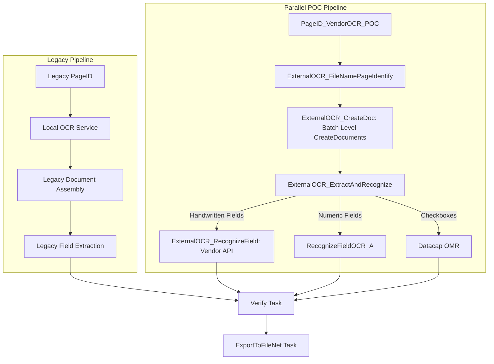

# Datacap Parallel Pipeline Migration Guide

Use this guide when adding a new OCR engine, AI service, or document classification pipeline to an existing IBM Datacap application (e.g. GoldenDemo) alongside existing production workflows.

## 1. Zero-Collision Architecture Principles

To ensure complete non-interference:
1. **Never rename, delete, disable, or edit legacy files**:
   - Keep legacy rulesets (e.g., `localocr_pageidentify.rul`, `localocr_extractfields.rul`, `createdoc2.rul`) untouched.
   - Keep legacy DLLs and RRX wrappers (e.g., `LocalOCRActions.dll`) intact in `C:\Datacap\RRS\`.
   - Keep legacy task profiles (`PageID`, `Profiler`, `Export`) valid and functional.
2. **Use isolated naming conventions**:
   - Use dedicated action names (`ExternalOCR_*`).
   - Use dedicated ruleset IDs and file names (`externalocr_pageidentify.rul` with ID `20`, `externalocr_createdoc.rul` with ID `21`, `externalocr_extractandrecognize.rul` with ID `22`).
   - Create a dedicated task profile (e.g. `PageID_VendorOCR_POC`).
3. **Do not use vendor product names in Datacap components**:
   - Use generic action, class, ruleset, and variable names.

---

## 2. Parallel Workflow Structure



---

## 3. Step-by-Step Implementation Blueprint

### Step 1: Create Independent Rulesets
1. **Ruleset 20 (`externalocr_pageidentify.rul`)**:
   - Level: Page (`P`)
   - Action: `ExternalOCRActions.ExternalOCR_FileNamePageIdentify`
2. **Ruleset 21 (`externalocr_createdoc.rul`)**:
   - Level: Batch (`B`)
   - Action: `CreateDocuments()` (creates document structure only; does NOT call `CreateFields()`)
3. **Ruleset 22 (`externalocr_extractandrecognize.rul`)**:
   - Rule 1 (Page level): Set RTL bidi, Arabic locale, call `CreateFields()`
   - Rule 2 (Handwritten fields): `dcomap.open="F=Field1;F=Field2"` $\rightarrow$ `ExternalOCR_RecognizeField`
   - Rule 3 (Numeric fields): `dcomap.open="F=NationalIdNumber;F=AccountNumber"` $\rightarrow$ `RecognizeFieldOCR_A` (`net:RecognitionOCRA.OCRAActions`). `RecognizeFieldOCRPL` is not used (RRS error 17000008).

### Step 1b: Ruleset 23 (added later)
`externalocr_fixuproute.rul`, id 23, `ExternalOCR_FixupRoute`: page-level rule on `P=Other` that splits the batch to the Fixup job. Add it after 22 in both profiles. Full details in `datacap-fixup-manual-routing`.

> **Profile mapping:** the Navigator `PageID` task really runs `PageID_VendorOCR_POC`. Keep `PageID` and `PageID_VendorOCR_POC` in sync (20, 21, 22, 23). Rulerunner reads `collection.xml` only at start: restart it after edits.

### Step 2: Register in `collection.xml` & `<AppName>.app`
Add rulesets and the new task profile to `collection.xml`:
```xml
<rsc>
  ... (legacy rulesets preserved)
  <ruleset id="20" name="ExternalOCR_PageIdentify" depends=""/>
  <ruleset id="21" name="ExternalOCR_CreateDoc" depends=""/>
  <ruleset id="22" name="ExternalOCR_ExtractAndRecognize" depends=""/>
</rsc>
<tps>
  <tprofile name="PageID_VendorOCR_POC">
    <ruleset id="20"/>
    <ruleset id="21"/>
    <ruleset id="22"/>
  </tprofile>
</tps>
```

### Step 3: Create Task Profile Settings XML
Create `<AppDir>\dco_<AppName>\<TaskProfileName>.set.xml` (e.g. `PageID_VendorOCR_POC.set.xml`) pointing `TProfile` to `PageID_VendorOCR_POC`.

---

## 4. Verification & Validation Checklist
Before releasing:
1. Verify legacy DLLs (`LocalOCRActions.dll`) still exist and pass standalone execution tests.
2. Confirm the new filename identify action classifies incoming test images correctly into target page types.
3. Confirm batch `CreateDocuments()` creates documents without instantiating empty fields prematurely.
4. Confirm `CreateFields()` runs only once per page right before recognition.
5. Verify that only cropped field images are sent to the external OCR API (never full pages).
6. Verify that runtime DCO XML (`tm00000x.xml`) contains populated values and Unicode decimal character nodes.
7. Verify FileNet export task receives intact documents and metadata.
