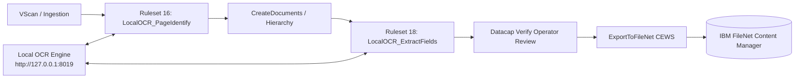

# IBM Datacap Local OCR & FileNet Integration Blueprint

## 1. Executive Summary & Architecture Overview

This blueprint documents the production-grade architecture and development lifecycle for integrating **IBM Datacap** with an on-premise **Local AI OCR Service** (`http://127.0.0.1:8019`) and exporting processed documents into **IBM FileNet Content Services**.



---

## 2. Core Execution Pipeline & DCO Lifecycle

A frequent point of failure in Datacap custom integrations is **lifecycle race conditions** where field data gets overwritten or initialized in the wrong sequence.

### Mandatory Execution Sequence:

1. **Page Identification (`LocalOCR_PageIdentify`)**:
   - Inspects the page image (`.tif` / `.jpg` / `.png`).
   - Converts the image into Base64 in memory.
   - Calls `POST http://127.0.0.1:8019/identify`.
   - Sets `CurrentDCO.Type` to the identified page type (e.g., `Signature_Form_1`, `National ID Front`, `Form_Page_1`).
   - Calls `CurrentDCO.CreateFields()` to instantiate field children in runtime DCO.
   - If confidence is low ($< 0.80$) or `review_required == true`, sets `CurrentDCO.Status = 1` for human review.

2. **Document Assembly (`CreateDocuments`)**:
   - Evaluates page rules and groups identified pages under `<D>` document nodes.
   - **Crucial Rule**: `CreateDocuments` MUST execute *before* field data extraction. If it runs after extraction, it re-instantiates fields and clears extracted text values.

3. **Field Data Extraction (`LocalOCR_ExtractFields`)**:
   - Executes at the page level for classified pages.
   - Calls `POST http://127.0.0.1:8019/recognize` with specific active adapters (`account_holder_name`, `employer_name`).
   - Iterates through extracted key-value pairs and writes to child fields:
     - `fieldDCO.Text = extractedValue`
     - Populates character confidence strings (`fieldDCO.Confidence = "9999..."`)
   - Flags uncertain fields or missing required values with `fieldDCO.Status = 1`.

4. **Verification Task (`Verify`)**:
   - Human operators review only pages and fields where `Status == 1`.

5. **FileNet Export (`ExportToFileNet`)**:
   - Connects to IBM FileNet via CEWS / GraphQL.
   - Checks in document versions with mapped custom properties into designated folders.

---

## 3. Custom Action Implementation Standards

All C# custom actions for Rulerunner Service (RRS) must conform to the following standards:

### Required RRS Reflection Properties:
```csharp
protected dynamic RRLog      = null;
protected dynamic RRState    = null;
protected dynamic BatchPilot = null;
protected dynamic DCO        = null;
protected dynamic CurrentDCO = null;

public dynamic DatacapRRLog { set { this.RRLog = value; GC.Collect(); GC.WaitForPendingFinalizers(); } get { return this.RRLog; } }
public dynamic DatacapRRState { set { this.RRState = value; GC.Collect(); GC.WaitForPendingFinalizers(); } get { return this.RRState; } }
public dynamic DatacapRRBatchPilot { set { this.BatchPilot = value; GC.Collect(); GC.WaitForPendingFinalizers(); } get { return this.BatchPilot; } }
public dynamic DatacapRRDCO { set { this.DCO = value; GC.Collect(); GC.WaitForPendingFinalizers(); } get { return this.DCO; } }
public dynamic DatacapRRCurrentDCO { set { this.CurrentDCO = value; GC.Collect(); GC.WaitForPendingFinalizers(); } get { return this.CurrentDCO; } }
public bool DatacapRRCleanupTime {
    set {
        if (value) {
            RRLog = null; RRState = null; BatchPilot = null; DCO = null; CurrentDCO = null;
            GC.Collect(); GC.WaitForPendingFinalizers();
        }
    }
}
```

### Action Return Codes:
- `0`: Success (Rule continues).
- `1`: Condition not met / Validation failed (Rulerunner proceeds to next function in rule).
- `99`: Fatal exception (Aborts batch execution).

---

## 4. DCO Document & Field Mapping Catalog

| Document / Form Name | Datacap Page Type (`CurrentDCO.Type`) | Target DCO Fields | Local OCR Source Key |
| :--- | :--- | :--- | :--- |
| **Signature Specimen** | `Signature_Form_1` | `AccountHolderName`<br>`AccountNumber` | `AccountHolderName`<br>`AccountNumber` (16 digits) |
| **National ID (Front)** | `National ID Front` | `FullNameArabic`<br>`FamilyNameArabic`<br>`AddressArabic`<br>`NationalIdNumber`<br>`EmployerName` | `FullNameArabic`<br>`FamilyNameArabic`<br>`AddressArabic`<br>`NationalIdNumber`<br>`EmployerName` |
| **NPA Application Form**| `Form_Page_1` | `EmployerName2`<br>`AvrgMonthlyIncome` | `EmployerName2`<br>`AvrgMonthlyIncome` (`Less Than 10,000`) |

---

## 5. Automated Build & Deployment Recipe

To build without Visual Studio on any Datacap server:

```cmd
@echo off
set CSC=C:\Windows\Microsoft.NET\Framework64\v4.0.30319\csc.exe
set OUT_DIR=C:\Datacap\RRS
set APP_RULES_DIR=C:\Datacap\GoldenDemo\dco_GoldenDemo\rules

%CSC% /target:library /platform:anycpu /optimize+ ^
  /out:"%OUT_DIR%\LocalOCRActions.dll" ^
  /reference:System.dll,System.Core.dll,System.Web.Extensions.dll ^
  C:\Datacap\LocalOCRActions\src\*.cs

copy /Y "%OUT_DIR%\LocalOCRActions.dll" "%APP_RULES_DIR%\"
copy /Y "C:\Datacap\LocalOCRActions\RRS\LocalOCRActions.rrx" "%OUT_DIR%\"
copy /Y "C:\Datacap\LocalOCRActions\RRS\LocalOCRActions.rrx" "%APP_RULES_DIR%\"
```

---

## 6. Standalone Verification Checklist

Before running batches through Datacap Taskmaster:
1. Verify Local OCR service health: `Invoke-RestMethod http://127.0.0.1:8019/health`.
2. Verify active adapters: `Invoke-RestMethod http://127.0.0.1:8019/model-info`.
3. Run `Test-LocalOCR.ps1` against sample form images to ensure JSON parsing and confidence scores are valid.
4. Verify task profile sequencing in `collection.xml`.
